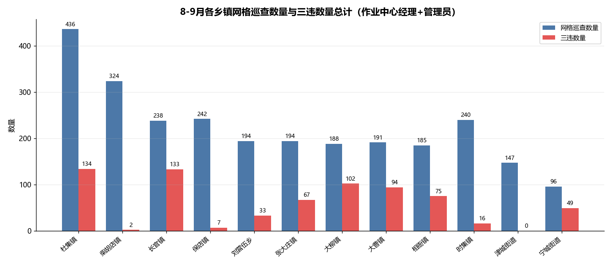
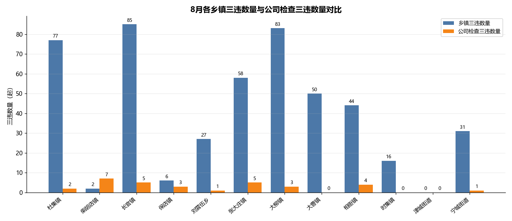
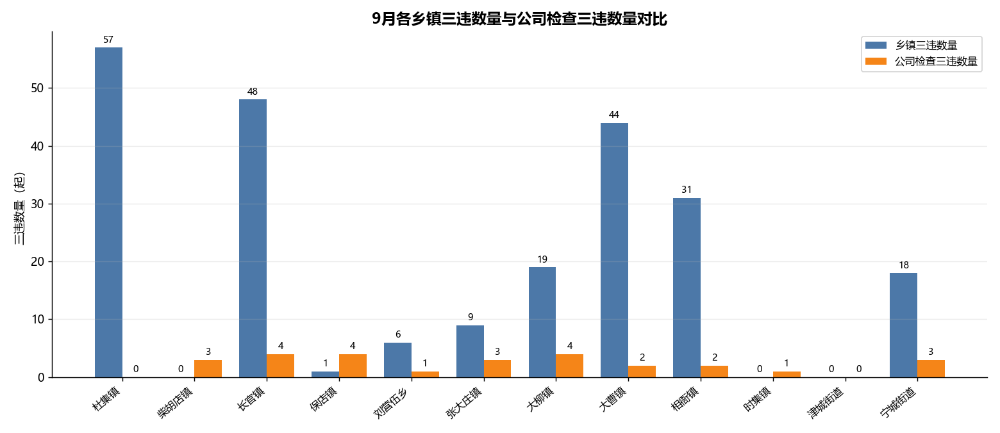
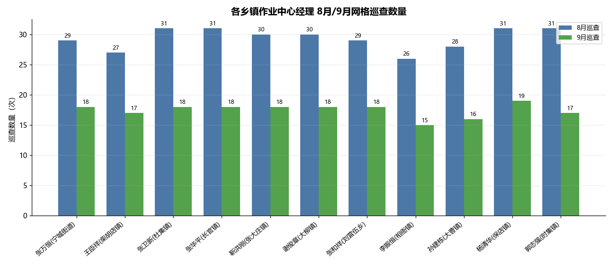
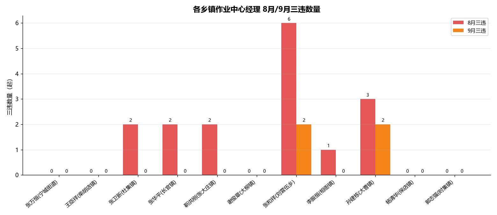

# 网格长巡查及三违统计汇总（2026 年 8—9 月）

> 数据源：`8月网格长巡查及三违统计_按主表纠错.xlsx`、`9月网格长巡查及三违统计_按主表纠错.xlsx`
> 统计日期：2026-09-21

## 统计口径说明

- **乡镇作业中心经理**：二级网格长中「职位=乡镇作业中心经理」的人员（11 人）。
- **管理员**：三级网格长（乡镇作业中心管理员）。
- **公司检查 / 公司管理**：总网格长 + 一级网格长合并归为「公司管理」一类；其「三违按乡镇」依据员工花名册「所属部门」去班组后缀归乡镇（2026-09-21 冻结口径）。
- 巡查数量 = 有效巡查记录行数；三违数量 = 「违章人姓名」非空且不为「--」的记录条数。

---

## 一、8—9 月总计（各乡镇作业中心经理 + 管理员）

| 乡镇 | 网格巡查数量（8+9 总计） | 三违数量（8+9 总计） |
| --- | ---: | ---: |
| 杜集镇 | 436 | 134 |
| 柴胡店镇 | 324 | 2 |
| 长官镇 | 238 | 133 |
| 保店镇 | 242 | 7 |
| 刘营伍乡 | 194 | 33 |
| 张大庄镇 | 194 | 67 |
| 大柳镇 | 188 | 102 |
| 大曹镇 | 191 | 94 |
| 相衙镇 | 185 | 75 |
| 时集镇 | 240 | 16 |
| 津城街道 | 147 | 0 |
| 宁城街道 | 96 | 49 |
| **合计** | **2675** | **712** |

---

## 二、各乡镇三违数量 与 公司检查三违数量对比

### 2.1 8 月

| 乡镇 | 乡镇三违数量 | 公司检查三违数量 |
| --- | ---: | ---: |
| 杜集镇 | 77 | 2 |
| 柴胡店镇 | 2 | 7 |
| 长官镇 | 85 | 5 |
| 保店镇 | 6 | 3 |
| 刘营伍乡 | 27 | 1 |
| 张大庄镇 | 58 | 5 |
| 大柳镇 | 83 | 3 |
| 大曹镇 | 50 | 0 |
| 相衙镇 | 44 | 4 |
| 时集镇 | 16 | 0 |
| 津城街道 | 0 | 0 |
| 宁城街道 | 31 | 1 |
| **合计** | **479** | **31** |

> 注：8 月公司检查三违共 33 起，其中 31 起可归入乡镇，另有 2 起「未匹配」（孙艳红、张宝树未命中花名册）。

### 2.2 9 月

| 乡镇 | 乡镇三违数量 | 公司检查三违数量 |
| --- | ---: | ---: |
| 杜集镇 | 57 | 0 |
| 柴胡店镇 | 0 | 3 |
| 长官镇 | 48 | 4 |
| 保店镇 | 1 | 4 |
| 刘营伍乡 | 6 | 1 |
| 张大庄镇 | 9 | 3 |
| 大柳镇 | 19 | 4 |
| 大曹镇 | 44 | 2 |
| 相衙镇 | 31 | 2 |
| 时集镇 | 0 | 1 |
| 津城街道 | 0 | 0 |
| 宁城街道 | 18 | 3 |
| **合计** | **233** | **27** |

> 注：9 月公司检查三违共 27 起，全部可归入乡镇，「未匹配」0 起。

---

## 三、各乡镇作业中心经理 巡查 / 三违统计

### 3.1 网格巡查统计（次）

| 经理 | 乡镇 | 8 月 | 9 月 | 合计 |
| --- | --- | ---: | ---: | ---: |
| 张万恒 | 宁城街道 | 29 | 18 | 47 |
| 王臣祥 | 柴胡店镇 | 27 | 17 | 44 |
| 张卫新 | 杜集镇 | 31 | 18 | 49 |
| 张华平 | 长官镇 | 31 | 18 | 49 |
| 靳洪刚 | 张大庄镇 | 30 | 18 | 48 |
| 谢俊章 | 大柳镇 | 30 | 18 | 48 |
| 张和祥 | 刘营伍乡 | 29 | 18 | 47 |
| 李振恒 | 相衙镇 | 26 | 15 | 41 |
| 孙建栋 | 大曹镇 | 28 | 16 | 44 |
| 杨清华 | 保店镇 | 31 | 19 | 50 |
| 郭志强 | 时集镇 | 31 | 17 | 48 |
| **合计** | — | **323** | **192** | **515** |

### 3.2 三违数量统计（起）

| 经理 | 乡镇 | 8 月 | 9 月 | 合计 |
| --- | --- | ---: | ---: | ---: |
| 张万恒 | 宁城街道 | 0 | 0 | 0 |
| 王臣祥 | 柴胡店镇 | 0 | 0 | 0 |
| 张卫新 | 杜集镇 | 2 | 0 | 2 |
| 张华平 | 长官镇 | 2 | 0 | 2 |
| 靳洪刚 | 张大庄镇 | 2 | 0 | 2 |
| 谢俊章 | 大柳镇 | 0 | 0 | 0 |
| 张和祥 | 刘营伍乡 | 6 | 2 | 8 |
| 李振恒 | 相衙镇 | 1 | 0 | 1 |
| 孙建栋 | 大曹镇 | 3 | 2 | 5 |
| 杨清华 | 保店镇 | 0 | 0 | 0 |
| 郭志强 | 时集镇 | 0 | 0 | 0 |
| **合计** | — | **16** | **4** | **20** |

---

## 附注

- 9 月数据覆盖 2026-09-01 至 09-18（18 天，未满月），与 8 月直接对比时需注意口径差异。
- 各乡镇三违数量为「乡镇作业中心经理 + 管理员」巡查所发现的三违；公司检查三违为「总网格长 + 一级网格长（公司管理）」检查所发现的三违。