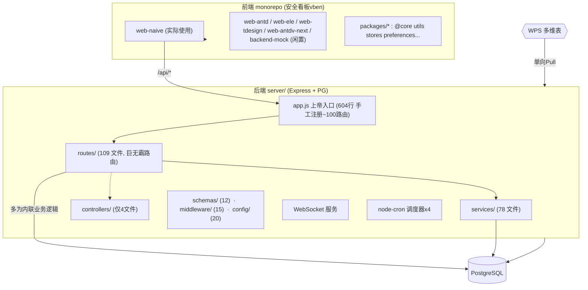

# HSE 安全管理系统 — 架构审计报告

> 审计日期：2026-09-12
> 审计方式：只读探测（目录结构 + 核心入口文件 + 配置 + 依赖），未触碰生产端口 5876 / 生产表 / WPS 写，符合生产边界规则。
> 前置说明：本报告基于对 `G:\hse-dashboard` 实际代码库的审计结果。该项目并非"刚新建的空项目"，而是已迭代多轮（Sprint 6/7/11...）的高复杂度既有系统，因此报告按真实状态编写，而非套用新建项目模板。

---

## 一、架构总览

### 1. 技术选型与实际构成

| 层 | 技术 | 说明 |
|---|---|---|
| 前端 | Vue3 + vue-vben-admin v5.7（monorepo，pnpm） | 实际在用 app=`web-naive`；另有 web-antd/ele/tdesign/antdv-next/backend-mock 5 个闲置 app |
| 后端 | Node.js≥22 + Express 4（纯 CommonJS JS）+ Postgres(pg) | 唯一入口 `server/app.js`，默认端口 5666 |
| 实时 | `ws`(WebSocket) | 与 Express 共用 HTTP server |
| 定时 | `node-cron` 4 个调度器 | 员工健康巡检(禁用)、月度考核、WPS 台账同步、台账导入 |
| 外部 | WPS 多维表（单向：WPS→Pull→PG→HSE）、AI 服务、IoT、BI 大屏 | 架构固化单向链路 |
| 安全 | helmet / express-rate-limit / JWT / multer | 已有一批较好实践 |

### 2. 分层模型（Mermaid）

### 3. 数据流与控制流
- **上游**：WPS 台账 → Pull 引擎 → 预写 PG → HSE 各模块消费；方向被架构**固化为单向**（`WPS→Pull→PG→HSE`）。
- **内部**：前端访问 `/api/*` → `app.js` 路由注册 → 路由文件（大部分内联 SQL/业务）或 Service → PG；WebSocket 承担实时推送；node-cron 调度月度考核与台账同步。
- **下游**：BI 大屏 / AI / IoT 作为 `/api/hse/*` 的子域挂在同一后端进程内。

---

## 二、问题清单（按严重程度降序）

### 🔴 P0 — 短期必须处理，否则会"越改越痛"

**P0-1 | 以"Sprint 号"命名模块而非按领域边界**（最严重的可维护性债务）
路由、服务几乎都以交付批次命名：`hse-assessment` / `hse-assessment-monthly` / `hse-assessment-analysis` / `hse-assessment-rule` / `hse-assessment-category` / `hse-assessment-analysis`……同一业务域被切成 6+ 个独立模块。更糟的是**同一领域被碎成多个 Route 前缀**：
`/api/risk-control`、`/api/hse/risk-profile`、`/api/hse/risk-score`、`/api/hse/risk/profile`、`/api/hse/driver-risk-center`。新增一个"某岗位风险"功能需要去猜归属模块 → **每加一个功能都痛苦，且极易写重复逻辑**。

**P0-2 | route 文件是"巨无霸"，controller 层形同虚设**（违反 SRP / 职责不清）
- `routes/` 109 个文件里，`hse-employee.js` 高达 **~34 万字节（约万行）**，`insurance.js` 18 万、`import.js` 18 万、`training.js` 13 万；Top20 里十几项都在 4 万字以上。
- 但 `controllers/` **只有 4 个文件**，几乎没在用 → 业务逻辑 70% 写死在 router 里，router 既是路由又是控制器又是 service 又是 SQL。分层失败，测试无从下手，改一个接口要啃上万行文件。

**P0-3 | 一次性脚本/临时产物直接亿元打进仓库**（版本库污染、无清理策略）
- `server/` 根目录直接躺着 **214 个一次性 `.js/.cjs`**（`_tmp_*`、`_check_*`、`_debug*`、`_fix_*`、`migrate-*`、`init-*`、`test-*`…），整个 server 目录（含 node_modules）共 **5263 个 .js/.cjs**。
- 项目根目录有数十个 `_*` 临时目录（`_backup*`、`_verify*`、`_shots*`、`_03a_*`）、大量 `.log`、`_shot_*.cjs` 截图脚本、`.xlsx` 测试文件、复制出的 `*.md` 报告。
- 这些既不是源码也不是文档，**可检索性崩塌，新人无法判断什么是生产代码**；git 历史会被目录清单拖垮。

**P0-4 | 双技术栈僵尸代码并存**（迷惑性与维护陷阱）
`package.json` 的 `start/dev` 指向 `node app.js`，但又保留整套 `src/`（26 个陈旧 TS 文件）、`tsconfig.json`、`jest.config.js`、`legacy:*` 脚本。**当前运行时和 dead code 混在同一文件夹**，容易误入 ts 版本。

**P0-5 | 根目录存在多个相互竞争的"平行子项目"**（决策分散、重复造轮子）
`rule-engine-design` / `rule-engine-comparison` / `open-assessment-system` / `assessment-rule-library` / `assessment-score-design` / `monthly-assessment-chain-report` / `grid-inspection-deduction-diagnosis`… 同一"考核规则/评分"主题存在多个 PoC/分析项目，口径以何者为准不透明，存在**回归与"两套实现打架"的风险**。

### 🟡 P1 — 中期改进，影响质量与效率

- **P1-1 API 命名空间混乱**：`/api/risk-control` 与 `/api/hse/*` 两套前缀并存；`vben-compat` 是"为对齐官方前端契约硬写的垫层"，接口契约会与真实实现双份维护。
- **P1-2 前端 monorepo 严重膨胀**：实际只用 `web-naive`，却保留 5 个闲置 app + `backend-mock` → 安装/构建变慢、类型检查面变大。从官方 template 原样搬来未做瘦身。
- **P1-3 依赖重复/陈旧**：同时 `bcrypt` + `bcryptjs`（冗余）；`multer ^1.4.5-lts.1` 偏旧；无 pnpm `overrides` 对高危/重复依赖做统一兜底。
- **P1-4 安全边界需复核（有良好基础，但要确认）**：`app.js` 已用 helmet/rate-limit/JWT/防目录穿越/410 处理，基础较好。需核对：`CORS_ALLOW_ALL=true` 是否会在生产被误开；通用 `/uploads` 静态目录（`app.js:271`）仍匿名可访问，需确认其下无敏感文件；所有 `requireRole` 覆盖是否与实际写操作匹配。
- **P1-5 配置与密钥散落**：`server/.env` 真实存在于 git 工作区（受 prod-boundary 保护）。需确认 `.env` 已被 `.gitignore` 排除，且 `_*_out.txt/_*.log` 等临时文件不含明文 token。

### 🟢 P2 — 低优先，顺手可清

- 前端根目录堆叠大量 `_shot_*.cjs`（Playwright 截图脚本）、`*.log`、`Xxx报告.md`，与源码混放。
- `schemas/`(12) 是 zod 校验，但 route 内是否普遍复用存疑（许多路线上万行，未必都走 schema），需抽查一致性。
- `metrics.js`、`middleware/requestLogger` 与 `morgan` 并存，日志链路有重复实现倾向。

---

## 三、改进建议（按优先级，含成本/收益）

### 🎯 短期（1 天内，低成本高收益）——"止血"
1. **建立完整 `.gitignore`，把一次性产物踢出版本库**：`*.log`、`*.xlsx`(测试数据)、`_tmp_*`、`_debug*`、`_verify*`、`_03a_*`、`_shot_*.cjs`、`backups/`、`uploads/`(运行时)。一次性脚本单独归档到 `scripts/adhoc/`，生产代码与实验代码从此分离。
   - 成本≈小时级；收益：可检索性、新人上手、CI 体积立竿见影。
2. **删/冻结平行子项目**：以 `docs/191副` 归档决策结论，只保留一个"权威考核规则实现"，其余标记为读档。

### 🎯 中期（1–2 周）——"减肥 + 分层"
3. **收敛后端分层**：先把 `app.js` 路由清单抽为 `routes/index.js` + Router 组合，避免上帝文件继续膨胀。
4. **"燃尽"巨无霸 route**：按领域（`assessment/risk/training/employee…`）把 Top 巨型文件拆成 `controllers/`（薄）+ `services/`（业务）+ `routes/`（纯绑定），并强制"新代码默认进 controller/service"。
   - 成本：中等（改结构非行为，可配合 jest 逐步迁移）；收益：可测试性、合并冲突、Review 体验。

### 🎯 中长期（可延后）——"重构基建"
5. **前端 monorepo 瘦身**：`pnpm-workspace` 只保留 `web-naive` + 所需 `packages/*`，删除闲置 app，`apps` 收敛到 1–2 个。
6. **消除双栈僵尸**：确认 `app.js` 为唯一真源后，将 `src/`、`legacy:*`、`tsconfig` 迁入 `_archive/` 或删除。
7. **引入领域边界与规则引擎收敛**：把"考核/扣分/风险画像"等收敛为 1–2 个领域模块 + 1 套规则库（`hse_assessment_rule` 已有雏形），避免"Sprint 命名"继续失控。
8. **审计接口契约**：将 `vben-compat` 的契约并入各对外 Router 文档（OpenAPI/swagger），消除双份维护。

---

## 四、后续深入所需补充信息

1. **`server/routes/hse-employee.js`（或任一巨文件）头部 100–200 行**：判断其内部结构（是否已内建 handler、是否集中用 schema）。
2. **`server/config/db.js` + 任一典型 service（如 `services/reportService.js`）开头**：确认连接复用与 SQL 组织方式。
3. **前端 `apps/web-naive/src/api` 与 `views/hse` 的关系**：判断前端是否已按模块对齐（若前端已模块化，后端按同样边界切分成本更低）。
4. **`.gitignore`（server 与根目录各一份）当前内容**：确认 P0-3 污染是否已在忽略列表。