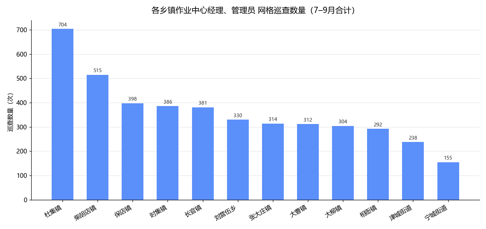
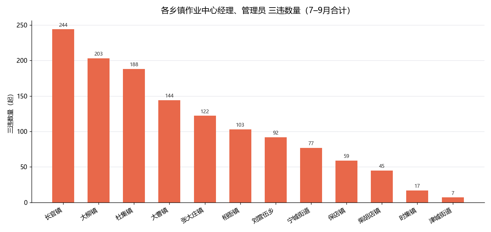
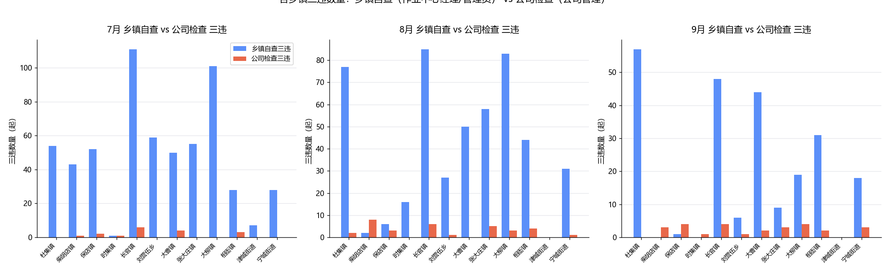
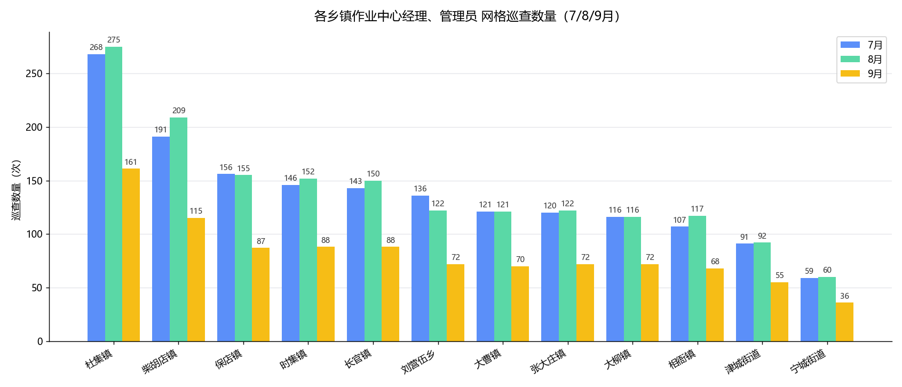
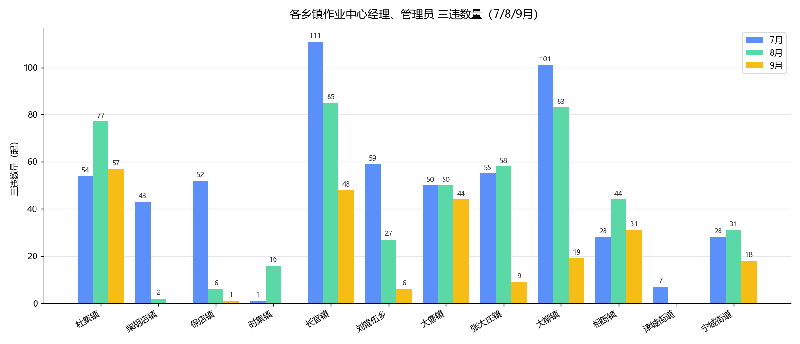

# 2026年7–9月三违统计分析（各乡镇作业中心）

> 数据来源：`2026年7/8/9月三违统计分析（按花名册）` 三份工作簿。统计口径见文末「附录」。

## 口径说明

- **网格长岗位**（仅限四类）：总经理、部门经理、**乡镇作业中心经理**、**管理员**。
- **等级映射**（《网格长花名册》权威口径）：
  - 总网格长（1人，总经理 黄殿兴）＋一级网格长（5人，部门经理） → **「公司管理」＝「公司检查」**，不按乡镇拆分巡查，仅按违章人所属乡镇统计三违。
  - 二级网格长（17人）＝**乡镇作业中心经理**；三级网格长（45人）＝**管理员** → 二者合并为各乡镇「作业中心」自查/上报口径，按片区（乡镇）统计。
- 因此，下表「乡镇」行均为 **作业中心经理＋管理员**（二级＋三级网格长）之和，不含公司管理。
- 9月数据仅覆盖 2026-09-01 ~ 09-18（18 天，未满月）。

## 一、7–9月总计（各乡镇作业中心经理+管理员）

| 乡镇 | 巡查数量合计（次） | 三违数量合计（起） |
|------|------:|------:|
| 杜集镇 | 704 | 188 |
| 柴胡店镇 | 515 | 45 |
| 保店镇 | 398 | 59 |
| 时集镇 | 386 | 17 |
| 长官镇 | 381 | 244 |
| 刘营伍乡 | 330 | 92 |
| 张大庄镇 | 314 | 122 |
| 大曹镇 | 312 | 144 |
| 大柳镇 | 304 | 203 |
| 相衙镇 | 292 | 103 |
| 津城街道 | 238 | 7 |
| 宁城街道 | 155 | 77 |
| **合计** | **4329** | **1301** |

## 二、各乡镇三违数量对比（乡镇自查 vs 公司检查）

| 乡镇 | 7月乡镇 | 7月公司 | 8月乡镇 | 8月公司 | 9月乡镇 | 9月公司 | 合计乡镇 | 合计公司 |
|------|------:|------:|------:|------:|------:|------:|------:|------:|
| 杜集镇 | 54 | 0 | 77 | 2 | 57 | 0 | 188 | 2 |
| 柴胡店镇 | 43 | 1 | 2 | 8 | 0 | 3 | 45 | 12 |
| 保店镇 | 52 | 2 | 6 | 3 | 1 | 4 | 59 | 9 |
| 时集镇 | 1 | 1 | 16 | 0 | 0 | 1 | 17 | 2 |
| 长官镇 | 111 | 6 | 85 | 6 | 48 | 4 | 244 | 16 |
| 刘营伍乡 | 59 | 0 | 27 | 1 | 6 | 1 | 92 | 2 |
| 大曹镇 | 50 | 4 | 50 | 0 | 44 | 2 | 144 | 6 |
| 张大庄镇 | 55 | 0 | 58 | 5 | 9 | 3 | 122 | 8 |
| 大柳镇 | 101 | 0 | 83 | 3 | 19 | 4 | 203 | 7 |
| 相衙镇 | 28 | 3 | 44 | 4 | 31 | 2 | 103 | 9 |
| 津城街道 | 7 | 0 | 0 | 0 | 0 | 0 | 7 | 0 |
| 宁城街道 | 28 | 0 | 31 | 1 | 18 | 3 | 77 | 4 |
| **合计** | **589** | **17** | **479** | **33** | **233** | **27** | **1301** | **77** |

> 注：7月公司检查三违另含「车队」1起、「未匹配」2起（非乡镇，未计入上表）；8/9月无此类项。

## 三、各乡镇每月巡查与三违统计

| 乡镇 | 7月巡查 | 7月三违 | 8月巡查 | 8月三违 | 9月巡查 | 9月三违 |
|------|------:|------:|------:|------:|------:|------:|
| 杜集镇 | 268 | 54 | 275 | 77 | 161 | 57 |
| 柴胡店镇 | 191 | 43 | 209 | 2 | 115 | 0 |
| 保店镇 | 156 | 52 | 155 | 6 | 87 | 1 |
| 时集镇 | 146 | 1 | 152 | 16 | 88 | 0 |
| 长官镇 | 143 | 111 | 150 | 85 | 88 | 48 |
| 刘营伍乡 | 136 | 59 | 122 | 27 | 72 | 6 |
| 大曹镇 | 121 | 50 | 121 | 50 | 70 | 44 |
| 张大庄镇 | 120 | 55 | 122 | 58 | 72 | 9 |
| 大柳镇 | 116 | 101 | 116 | 83 | 72 | 19 |
| 相衙镇 | 107 | 28 | 117 | 44 | 68 | 31 |
| 津城街道 | 91 | 7 | 92 | 0 | 55 | 0 |
| 宁城街道 | 59 | 28 | 60 | 31 | 36 | 18 |
| **合计** | **1654** | **589** | **1691** | **479** | **984** | **233** |

## 附录：口径与数据来源

- 巡查次数 = 有效记录行数（每行一次网格长巡查/上报）；三违数量 = 「违章人姓名」非空的记录行数。
- 7月有效巡查 1676 行、三违 609 起；8月 1725 行、三违 512 起；9月 1011 行、三违 260 起。
- 其中乡镇作业中心（经理+管理员）巡查 1654 / 1691 / 984，公司管理巡查 22 / 34 / 27；三违乡镇 589 / 479 / 233，公司管理 20 / 33 / 27。
- 公司检查（公司管理）三违按乡镇：违章人所属乡镇按员工花名册「所属部门」去班组后缀归属。
- 所有数字已与对应月份工作簿「说明」页总体汇总交叉核验一致。
