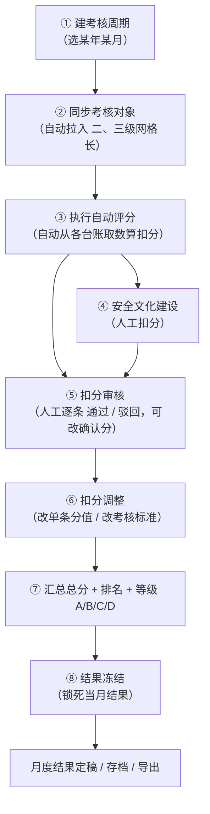

# 月度安全履职考核 — 扣分逻辑方案 + 流程说明（大白话版 · v2）

- 日期：2026-09-04（v2 依据用户澄清更新）

- 目标应用：`apps/web-naive`（Naive UI）

- 阅读对象：非技术背景的产品/业务负责人

- 关联文档：`00-结构逻辑分析`、`01-对话记录`、`02-验收补差-差异清单`

***

## 0. 一张图看懂「月度考核怎么跑」

> 一句话：**建周期 → 拉对象 → 算扣分 → 人工把关 → 定结果 → 锁死**。

***

## 1. 分数怎么改（都可配置、不写死）

| 想改什么                        | 在哪里改                               |
| --------------------------- | ---------------------------------- |
| 每个考核项/类别各自的**考核内容扣分 + 封顶分** | 【扣分规则库】→【类别扣分上限】，每行“扣分”与封顶可点改      |
| 某条**扣分规则**的详细/子项分值          | 【扣分规则库】→【扣分规则】                     |
| 某岗位**考核标准**某项分值             | 【人员管理】→【员工档案】→【扣分调整】(考核标准配置)，点单元格改 |
| 某月已算出的某条**确认扣分**            | 【月度考核】→【扣分审核】，通过时改“确认分值”           |

> 原则：**默认值我配好，之后你在页面改，系统按新值算**，不写死在代码里。

***

## 2. 确认后的扣分逻辑（考核对象 = 二、三级网格长）

| 考核项        | 封顶   | 扣分对象                    | 扣分内容/来源                                                                 | 方式           |
| ---------- | ---- | ----------------------- | ----------------------------------------------------------------------- | ------------ |
| 安全文化建设     | 20 分 | 网格长本人                   | 人工考核扣分（不自动取数）                                                           | 人工           |
| HSE教育培训    | 30 分 | **培训人本人那一级（网格长），不传导上级** | 【培训记录】当月「缺少」每 1 人扣 X 分 +「资料不完整」每 1 份扣 Y 分，累加到月；X/Y 为可选配置                | 自动取数、可配置     |
| 现场管理-驾驶员管理 | 20 分 | **传导到 XX 镇作业中心经理/主管**   | 【驾驶员管理】→【月度考核】三检表管理 / 灯牌污损 / 灯具失效 / 安全监控 / 消防管理；驾驶员每项/每次扣分传导到所属乡镇作业中心经理 | 自动 + 传导（可配置） |
| 现场管理-转运站管理 | 10 分 | **传导到 XX 镇作业中心经理/主管**   | 【驾驶员管理】→【转运站管理】；含转运站的消防；每项/每次传导到乡镇作业中心经理                                | 自动 + 传导（可配置） |
| 三违管理       | 15 分 | 网格长本人                   | 【网格管理】→【网格长巡查管理】+【三违管理】→【三违分析】：信息不完整(1) / 检查未反馈(1) / 自身三违行为(1)          | 自动取数         |

**重要口径（按你澄清）**

1. **“现场管理-消防管理”不再单列为一个考核项**：消防归并进“驾驶员消防”与“转运站消防”，分别在驾驶员管理、转运站管理里体现；无论分合，它们的**直接上级都是 XX 镇作业中心经理**。
2. **驾驶员 / 转运站扣分 → 传导到乡镇作业中心经理**：传导的分值、每项/每次扣多少，全部做成**可配置项**，不写死。
3. **HSE教育培训**：扣在**培训人本人那一级**，**不传导到上级**；“缺少”按每 1 人扣 X 分、“资料不完整”按每 1 份扣 Y 分，**逐项累加，统计到当月**；X/Y 可配置。

***

## 3. 实施思路（后端改动：以“逻辑贯穿、打通”为目标，不纠结改动量）

用户授权后端改动，核心目标是**让扣分逻辑在“数据后台 → 规则库 → 评分 → 审核 → 冻结”全链路贯串打通**，而不是存量改多少。

### 第一层：数据输入（各业务台账已存在）

- 培训记录（缺少 / 资料不完整）

- 驾驶员月度考核（三检表 / 灯牌污损 / 灯具失效 / 安全监控 / 消防管理）

- 转运站管理

- 网格长巡查 / 三违分析（信息不完整、检查未反馈、自身三违行为）

### 第二层：规则库配置（分数可配置）

- 【扣分规则】逐条挂到对应考核项、类型、来源表、分值/子项（放配置）。

- 【类别扣分上限】维护 5 项封顶 + 每行扣分。

### 第三层：传导引擎（打通的关键）

- 驾驶员/转运站扣分 → 按所属乡镇作业中心 → **传导到该中心作业中心经理**（复用 `hse-chain` 链式传导，分值可配置）。

- 培训、三违 → 扣在网格长本人，**不传导**。

- 消防：驾驶员消防归驾驶员项、转运站消防归转运站项，不单独成项。

### 第四层：评分 + 审核 + 冻结（沿用现流程）

- 执行评分按规则库配置计算 → 扣分审核（人工把关）→ 扣分调整（改分/改标准）→ 结果冻结。

***

## 4. 待你补全的数字（默认值）

1. 驾驶员每个子项（三检表 / 灯牌污损 / 灯具失效 / 安全监控 / 消防管理）**每次扣多少**？是否同一套分？
2. 转运站每个子项**每次扣多少**？
3. 传导到作业中心经理时**是原分值还是打折**（如每项×次、或按比例）？
4. 培训【缺少】**每人扣 X**、【资料不完整】**每份扣 Y**，X/Y 各是多少？

> 若暂未定，我可先按合理默认值配置（如每项每次 5 分、培训缺训每人 5 分、资料不完整每份 2 分等），后续你在页面自行修改。

