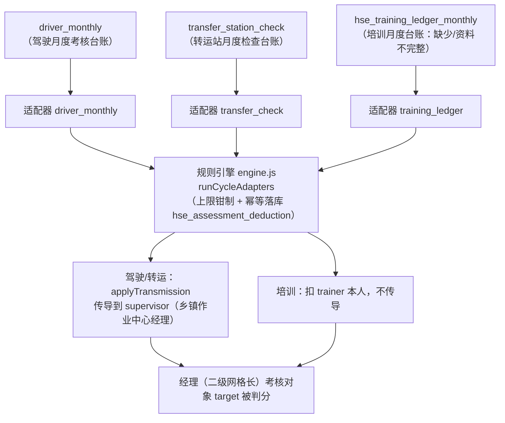

# 驾驶 / 转运站 / 培训台账 接入自动评分方案（驾驶+转运+培训台账）

- 日期：2026-09-04

- 目标：把「现场管理-驾驶员管理」「现场管理-转运站管理」「HSE教育培训」三块从台账数据接入月度安全履职考核的自动评分，并打通「传导到乡镇作业中心经理」。

- 目标应用：后端 `server`（规则引擎），前端不改（评分列表已动态读类别扣分上限）。

- 关联：`04-默认扣分配置表.md`（默认分值）、`00-结构逻辑分析`、`05-扣分配置操作手册`。

***

## 0. 现状盘点（基于代码，非猜测）

| 考核项            | 数据表                                            | 目前是否进评分引擎                  |
| -------------- | ---------------------------------------------- | -------------------------- |
| 安全文化建设（20）     | 人工                                             | 人工扣分                       |
| HSE教育培训（30）    | `hse_training_ledger_monthly`（应培训/实际/缺少/资料不完整） | **未接入**（仅旧「培训不合格」事件，口径不同）  |
| 现场管理-驾驶员管理（20） | `driver_monthly`（三检表/灯牌/灯具/安全监控/消防 计数）         | **未接入**                    |
| 现场管理-转运站管理（10） | `transfer_station_check`（台账/标识/用电/消防/物品 计数）    | **未接入**                    |
| 三违管理（15）       | `violation_records`                            | 已接入（violationAdapter + 传导） |

自动评分引擎适配器目前只有 `grid_unchecked`、`violation_record`（`violation_unrectified` 未激活）。

### 已确认的关键机制（本次依赖）

- **传导**：`applyTransmission`（assessmentEventService）把下属扣分 ×100%（`TRANSMISSION_RATIO=1.0`）传导到 `supervisor`（直属上级）的考核 target；上级须是考核对象。`getEmployeeWithManager` 从 `v_employee_org_full.supervisor_id` 取上级。

- **考核对象**：乡镇作业中心经理（二级网格长）＋管理员（三级网格长）＋网格长。经理本就在考核对象里，无需新增。

***

## 1. 架构图

> 驾驶/转运站：源记录是一名驾驶员/一个站点，扣分传导到其所属乡镇作业中心经理（supervisor）；培训：扣培训人本人，不传导上级。

***

## 2. 三块数据映射 → 扣分项/扣分对象 ⇄ 类别扣分上限

### 2.1 HSE教育培训（30）· 培训台账 `hse_training_ledger_monthly`

- 归属：按 `month`、`trainer_id/trainer_name`。`trainer` 为培训人（网格长/管理员）。

- 扣分项（对应表格"规则名称"行）：

  | 规则名称  | 取值                 | 口径            |
  | ----- | ------------------ | ------------- |
  | 缺少    | `missing_count`    | 每 1 人扣 X，累加到月 |
  | 资料不完整 | `incomplete_count` | 每 1 份扣 Y，累加到月 |

- 扣分对象：**trainer 本人**（不传导上级）。

- 幂等键：`training-ledger:{cycleId}:{trainerId}`（按人按月一条）。

- 默认分值：X=5 分/人，Y=2 分/份（沿用表04）。

### 2.2 现场管理-驾驶员管理（20）· `driver_monthly`

- 归属：按 `month`、`name/personnel_id`；驾驶员所在乡镇→乡镇作业中心经理。

- 扣分项（对应规则名称行）：

  | 规则名称  | 取值                       | 口径      |
  | ----- | ------------------------ | ------- |
  | 三检表管理 | `three_check_management` | 每项次扣，累加 |
  | 灯牌污损  | `lamp_dirty`             | 每项次扣，累加 |
  | 灯具失效  | `lamp_failure`           | 每项次扣，累加 |
  | 安全监控  | `safety_monitor`         | 每项次扣，累加 |
  | 消防管理  | `fire_management`        | 每项次扣，累加 |

- 扣分对象：**传导到该驾驶员所属乡镇作业中心经理**（supervisor）。

- 幂等键：`driver-monthly:{cycleId}:{name}`（按人按月一条）。

- 默认分值：每项 5 分/次（沿用表04）。

### 2.3 现场管理-转运站管理（10）· `transfer_station_check`

- 归属：按站点、片区/班组、所属乡镇；转运站所在乡镇→乡镇作业中心经理。

- 扣分项：

  | 规则名称  | 取值                   | 口径      |
  | ----- | -------------------- | ------- |
  | 台账管理  | `ledger_management`  | 每项次扣，累加 |
  | 标识牌管理 | `sign_management`    | 每项次扣，累加 |
  | 用电安全  | `electricity_safety` | 每项次扣，累加 |
  | 消防管理  | `fire_management`    | 每项次扣，累加 |
  | 物品摆放  | `item_placement`     | 每项次扣，累加 |

- 扣分对象：**传导到该转运站所属乡镇作业中心经理**（supervisor/片区）。

- 幂等键：`transfer-check:{cycleId}:{station}`（按站按月一条）。

- 默认分值：每项 5 分/次（沿用表04）。

***

## 3. 分值来源（不写死，兼容一张总表）

各适配器的"规则名称→分值"从 **「类别扣分上限」的** **`rule_items`** 读取：

- 若某行规则已配置 `deductScore` × 记录项次 → 用配置分；

- 未配置 → 用适配器内置默认分（上方表04 的 X/Y/每项分值）。

- 这样：页面改「类别扣分上限」里对应行分值即生效，无需改代码。与已在做的 `deduct_target`（扣分对象）一脉相承。

> 驾驶/转运站的 `deduct_target` 建议配「乡镇作业中心经理」，培训配「本人」。

***

## 4. 实施改动（最小集）

| 文件                                                                | 改动                                                                      |
| ----------------------------------------------------------------- | ----------------------------------------------------------------------- |
| 新建 `server/services/ruleEngine/adapters/driverMonthlyAdapter.js`  | 扫描 `driver_monthly`，产出扣分意图，传导到 supervisor                               |
| 新建 `server/services/ruleEngine/adapters/transferCheckAdapter.js`  | 扫描 `transfer_station_check`，产出扣分意图，传导到 supervisor                       |
| 新建 `server/services/ruleEngine/adapters/trainingLedgerAdapter.js` | 扫描 `hse_training_ledger_monthly`，扣除 trainer 本人                          |
| `server/services/ruleEngine/engine.js`                            | `AUTO_DEDUCTION_ADAPTERS` 追加三个 key；`ensureAdaptersRegistered` 注册 3 个适配器 |
| （增强）`assessmentEventService` / engine 的传导渲染                       | 适配器内为驾驶/转运自行处理 supervisor 传导，或复用一个通用"传导意图"接口                            |
| 测试                                                                | 为 3 个适配器补单元测试；构造 driver/transfer/training 台账数据验证扣分+传导落点正确               |

### 口径与边界

- 驾驶/转运站扣分**传导到乡镇作业中心经理**：用驾驶员的 supervisor（若其 supervisor 非"乡镇作业中心经理"，按乡镇兜底定位该乡镇经理）。

- 若某驾驶员/站点无法定位到乡镇作业中心经理 → 该记录 `skipped`（reason='no-manager'），不扣分不报错。

- 幂等：按人/站/月一条，重复运行不重复扣分；台账数据回滚/软删时撤销对应扣分。

- 不影响现有 `grid_unchecked`/`violation_record`；不动其它模块（web-antd、登录、路由）。

***

## 5. 待你确认（默认值 + 落点口径）

1. **默认分值**是否沿用表04（驾驶/转运每项 5 分/次；培训 缺少5/份 资料不完整2）？
2. **驾驶/转运传导对象**统一为"该驾驶员/站点所属乡镇作业中心经理"（supervisor 兜底乡镇），可否？
3. 驾驶/转运/培训三条链是否都先进**自动评分**（不进暂存/待审，与三违一致直接入 hse\_assessment\_deduction）？

