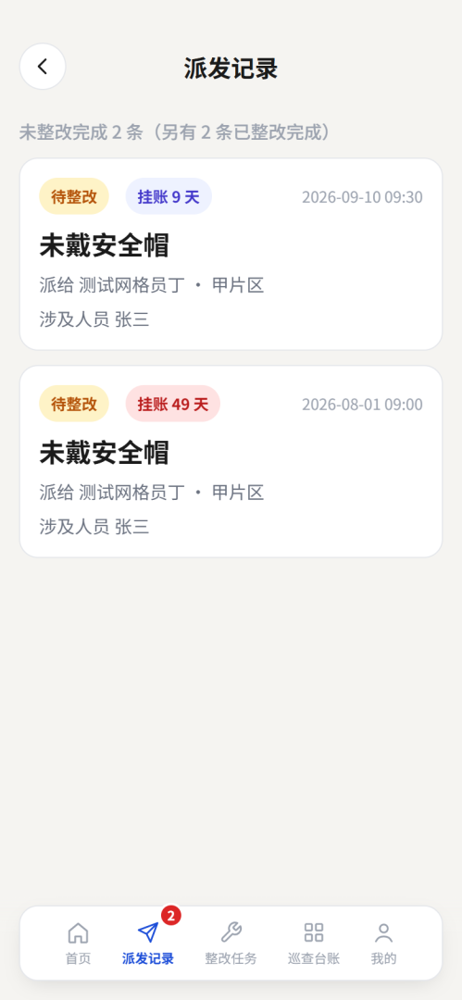

# 网格移动端 H5 — 全场景联调报告 (CF-WPS-58)

生成时间: 2026-09-19 23:21:38 (GMT+8)
运行环境: H5 = https://grid-mobile-cloudflare.pages.dev ; Worker = grid-mobile-cloudflare-worker
测试图片: 仅 img1.png + img2.png, 所有三违场景均上传这两张.

## 0. 总体结果

### 0.0 重要更正：24 项「通过」实为假阳性

首轮统计 183/204, 但业务方指出一条口径: **身份表的「角色」压过花名册的「职位」** ——
账号若是「公司管理」, 即便花名册把它写成某作业中心的经理, 它**也不应被当作乡镇作业中心经理来指派**.

按此口径重判后:

| 判定 | 数量 | 说明 |
|---|:-:|---|
| **有效通过** | **159** | 真·乡镇作业中心经理 或 公司管理/管理员 自身场景 |
| 无效通过(假阳性) | 24 | 用【公司管理】黄元同账号冒充乡镇经理, 分布在 5 个单位 |
| 真实失败 | 2 | 中心公园 孙海清 无网格 |
| 因缺人跳过 | 19 | 无管理员岗位 / 管理员无手机号 / 无乡镇经理 |
| 合计 | 204 | |

**17 个单位里只有 11 个有真正的「乡镇作业中心经理」**:
保店镇(杨清华)、柴胡店镇(王臣祥)、大曹镇(孙建栋)、大柳镇(谢俊章)、杜集镇(张卫新)、
刘营伍乡(张和祥)、宁城街道(张万恒)、时集镇(郭志强)、相衙镇(李振恒)、张大庄镇(靳洪刚)、长官镇(张华平).

另 6 个单位 `org/towns` 报的经理其实是公司管理账号(黄元同×5、刘菲×1), 或压根为空(津城街道).

#### 24 项假阳性明细

| 单位 | 场景 | 冒牌经理 |
|---|---|---|
| 中心公园 | S2 公司管理三违→指派乡镇经理 | 黄元同 |
| 中心公园 | S4a 经理自巡查(无三违)自整改 | 黄元同 |
| 中心公园 | S4b 经理自巡查(三违)自整改 | 黄元同 |
| 中心公园 | S5 经理三违→指派管理员 | 黄元同 |
| 中心公园 | S10 管理员接收经理指派→完成 | 黄元同 |
| 中心公园 | S6 经理接收公司管理指派→自己完成 | 黄元同 |
| 中心公园 | S7 经理接收公司管理指派→转派管理员 | 黄元同 |
| 中心公园 | S9 管理员接收(公司管理→经理→管理员)→完成 | 黄元同 |
| 市政园林作业中心 | S2 公司管理三违→指派乡镇经理 | 黄元同 |
| 市政园林作业中心 | S4a 经理自巡查(无三违)自整改 | 黄元同 |
| 市政园林作业中心 | S4b 经理自巡查(三违)自整改 | 黄元同 |
| 市政园林作业中心 | S6 经理接收公司管理指派→自己完成 | 黄元同 |
| 康宁湖公园 | S2 公司管理三违→指派乡镇经理 | 黄元同 |
| 康宁湖公园 | S4a 经理自巡查(无三违)自整改 | 黄元同 |
| 康宁湖公园 | S4b 经理自巡查(三违)自整改 | 黄元同 |
| 康宁湖公园 | S6 经理接收公司管理指派→自己完成 | 黄元同 |
| 新河公园 | S2 公司管理三违→指派乡镇经理 | 黄元同 |
| 新河公园 | S4a 经理自巡查(无三违)自整改 | 黄元同 |
| 新河公园 | S4b 经理自巡查(三违)自整改 | 黄元同 |
| 新河公园 | S6 经理接收公司管理指派→自己完成 | 黄元同 |
| 环卫作业中心 | S2 公司管理三违→指派乡镇经理 | 黄元同 |
| 环卫作业中心 | S4a 经理自巡查(无三违)自整改 | 黄元同 |
| 环卫作业中心 | S4b 经理自巡查(三违)自整改 | 黄元同 |
| 环卫作业中心 | S6 经理接收公司管理指派→自己完成 | 黄元同 |

### 0.1 单位级明细（已按新口径重判）

| 单位 | 公司管理 | org/towns 报的经理 | 该人真实角色 | 有效 | 假阳性 | 真失败 | 跳过 |
|---|---|---|:-:|:-:|:-:|:-:|:-:|
| 保店镇 | 黄殿兴 | 杨清华 | 真乡镇经理 | 13 | - | - | - |
| 大曹镇 | 黄殿兴 | 孙建栋 | 真乡镇经理 | 13 | - | - | - |
| 相衙镇 | 刘金涛 | 李振恒 | 真乡镇经理 | 13 | - | - | - |
| 时集镇 | 刘金涛 | 郭志强 | 真乡镇经理 | 13 | - | - | - |
| 刘营伍 | 张康 | 张和祥 | 真乡镇经理 | 13 | - | - | - |
| 张大庄镇 | 张康 | 靳洪刚 | 真乡镇经理 | 13 | - | - | - |
| 柴胡店镇 | 孟祥宇 | 王臣祥 | 真乡镇经理 | 13 | - | - | - |
| 大柳镇 | 孟祥宇 | 谢俊章 | 真乡镇经理 | 13 | - | - | - |
| 杜集镇 | 孟祥宇 | 张卫新 | 真乡镇经理 | 13 | - | - | - |
| 长官镇 | 孟祥宇 | 张华平 | 真乡镇经理 | 13 | - | - | - |
| 津城街道 | 韩晓亮 | (无) | **公司管理** | 5 | - | - | 3 |
| 宁城街道 | 韩晓亮 | 张万恒 | 真乡镇经理 | 13 | - | - | - |
| 环卫作业中心 | 刘菲 | 黄元同 | **公司管理** | 2 | 4 | - | 4 |
| 市政园林作业中心 | 黄元同 | 黄元同 | **公司管理** | 2 | 4 | - | 4 |
| 康宁湖公园 | 黄元同 | 黄元同 | **公司管理** | 2 | 4 | - | 4 |
| 新河公园 | 黄元同 | 黄元同 | **公司管理** | 2 | 4 | - | 4 |
| 中心公园 | 黄元同 | 黄元同 | **公司管理** | 3 | 8 | 2 | - |
| **合计** | 7 个账号 | — | — | **159** | 24 | 2 | 19 |

11 个有真乡镇经理的单位**全部 13/13 有效通过**; 6 个单位因「经理其实是公司管理账号」或「无人」产生 24 项假阳性 + 19 项跳过; 中心公园另有 2 项真失败.

## 1. 业务场景映射(共 10 大类 13 子项)

| 编号 | 业务含义 |
|---|---|
| 1 S1a | 公司管理自巡查(无三违)自己整改 |
| 2 S1b | 公司管理自巡查(三违)自己整改 |
| 3 S2 | 公司管理发现三违 - 指派乡镇作业中心经理 |
| 4 S3 | 公司管理发现三违 - 指派管理员 |
| 5 S4a | 乡镇作业中心经理自巡查(无三违)自己整改 |
| 6 S4b | 乡镇作业中心经理自巡查(三违)自己整改 |
| 7 S5 | 乡镇作业中心经理发现三违 - 指派管理员 |
| 8 S6 | 乡镇作业中心经理接收公司管理指派 - 自己完成 |
| 9 S7 | 乡镇作业中心经理接收公司管理指派 - 转派管理员 |
| 10 S9 | 管理员接收(公司管理-经理-管理员)两级链路 - 完成 |
| 11 S8a | 管理员自巡查(无三违)自己整改 |
| 12 S8b | 管理员自巡查(三违)自己整改 |
| 13 S10 | 管理员接收经理指派 - 完成 |

## 2. 单位 - 公司管理账号 映射(按用户指定)

| 公司管理 | 单位 |
|---|---|
| 黄殿兴 (项目管理层) | 保店镇,大曹镇 |
| 刘金涛 (安环管理部) | 相衙镇,时集镇 |
| 张康 (生产管理部) | 刘营伍,张大庄镇 |
| 孟祥宇 (安环管理部) | 柴胡店镇,大柳镇,杜集镇,长官镇 |
| 韩晓亮 (环卫作业中心) | 津城街道,宁城街道 |
| 刘菲 (环卫作业中心) | 环卫作业中心 |
| 黄元同 (市政园林作业中心) | 市政园林作业中心,康宁湖公园,新河公园,中心公园 |

7 个公司管理账号全部使用, 覆盖全部 17 个单位.

## 3. 详细记录明细(每条可与飞书台账 recvvXXX 对照)

每条记录都在飞书主台账 tbl5QiCv5Qbal044 落库, 写入「备注」中包含 T58Sxx... 幂等键前缀, 便于检索.

### 3.1 保店镇 (公司管理: 黄殿兴, 经理: 杨清华, 管理员: 回伦山,林中鹏,翟中坡,康景英)

| 场景 | 通过 | 记录 ID | 详情 |
|---|:-:|---|---|
| S1a 公司管理自巡查(无三违)自整改 | 是 | recvvHXmsuAQKa | cid=T58Smu8ym3pz6iaq |
| S1b 公司管理自巡查(三违)自整改 | 是 | recvvHXnAGVQNO |  |
| S2 公司管理三违→指派乡镇经理 | 是 | recvvHXoXycXDF | -> 杨清华 assigned=true |
| S3 公司管理三违→指派管理员 | 是 | recvvHXq7VHtGU | -> 回伦山 assigned=true |
| S4a 经理自巡查(无三违)自整改 | 是 | recvvHXryzOuUZ |  |
| S4b 经理自巡查(三违)自整改 | 是 | recvvHXsH7GbQq |  |
| S5 经理三违→指派管理员 | 是 | recvvHXu1r9BLn | -> 回伦山 |
| S10 管理员接收经理指派→完成 | 是 | recvvHXu1r9BLn | status=200 |
| S6 经理接收公司管理指派→自己完成 | 是 | recvvHXoXycXDF | status=200 |
| S7 经理接收公司管理指派→转派管理员 | 是 | recvvHXxcN8jPX | -> 回伦山 status=200 |
| S9 管理员接收(公司管理→经理→管理员)→完成 | 是 | recvvHXxcN8jPX | status=200 |
| S8a 管理员自巡查(无三违)自整改 | 是 | recvvHXAWW9LIp |  |
| S8b 管理员自巡查(三违)自整改 | 是 | recvvHXC8UJcmn |  |

### 3.2 大曹镇 (公司管理: 黄殿兴, 经理: 孙建栋, 管理员: 张运志,车书新,李怀英)

| 场景 | 通过 | 记录 ID | 详情 |
|---|:-:|---|---|
| S1a 公司管理自巡查(无三违)自整改 | 是 | recvvHXF2RfHLm | cid=T58Smu8ynmmw62cx |
| S1b 公司管理自巡查(三违)自整改 | 是 | recvvHXGfAXB0j |  |
| S2 公司管理三违→指派乡镇经理 | 是 | recvvHXHxUNtbd | -> 孙建栋 assigned=true |
| S3 公司管理三违→指派管理员 | 是 | recvvHXIDFOtSS | -> 张运志 assigned=true |
| S4a 经理自巡查(无三违)自整改 | 是 | recvvHXK56cW68 |  |
| S4b 经理自巡查(三违)自整改 | 是 | recvvHXLaXlJia |  |
| S5 经理三违→指派管理员 | 是 | recvvHXMyyEAEs | -> 张运志 |
| S10 管理员接收经理指派→完成 | 是 | recvvHXMyyEAEs | status=200 |
| S6 经理接收公司管理指派→自己完成 | 是 | recvvHXHxUNtbd | status=200 |
| S7 经理接收公司管理指派→转派管理员 | 是 | recvvHXPIMQax8 | -> 张运志 status=200 |
| S9 管理员接收(公司管理→经理→管理员)→完成 | 是 | recvvHXPIMQax8 | status=200 |
| S8a 管理员自巡查(无三违)自整改 | 是 | recvvHXTrViAQ3 |  |
| S8b 管理员自巡查(三违)自整改 | 是 | recvvHXUBeiPY9 |  |

### 3.3 相衙镇 (公司管理: 刘金涛, 经理: 李振恒, 管理员: 陈庆祥,李忠胜,张相岗)

| 场景 | 通过 | 记录 ID | 详情 |
|---|:-:|---|---|
| S1a 公司管理自巡查(无三违)自整改 | 是 | recvvHXXjU7fPQ | cid=T58Smu8yp55qhwde |
| S1b 公司管理自巡查(三违)自整改 | 是 | recvvHXYsDsMwv |  |
| S2 公司管理三违→指派乡镇经理 | 是 | recvvHXZLKbY9C | -> 李振恒 assigned=true |
| S3 公司管理三违→指派管理员 | 是 | recvvHY0TEcTnW | -> 陈庆祥 assigned=true |
| S4a 经理自巡查(无三违)自整改 | 是 | recvvHY2lf0Uxf |  |
| S4b 经理自巡查(三违)自整改 | 是 | recvvHY3ubVLuq |  |
| S5 经理三违→指派管理员 | 是 | recvvHY4QbGbX7 | -> 陈庆祥 |
| S10 管理员接收经理指派→完成 | 是 | recvvHY4QbGbX7 | status=200 |
| S6 经理接收公司管理指派→自己完成 | 是 | recvvHXZLKbY9C | status=200 |
| S7 经理接收公司管理指派→转派管理员 | 是 | recvvHY82j2m96 | -> 陈庆祥 status=200 |
| S9 管理员接收(公司管理→经理→管理员)→完成 | 是 | recvvHY82j2m96 | status=200 |
| S8a 管理员自巡查(无三违)自整改 | 是 | recvvHYbBw7NuE |  |
| S8b 管理员自巡查(三违)自整改 | 是 | recvvHYcJubZQS |  |

### 3.4 时集镇 (公司管理: 刘金涛, 经理: 郭志强, 管理员: 苏书红,郭秀梅,李先菊,刘秀梅)

| 场景 | 通过 | 记录 ID | 详情 |
|---|:-:|---|---|
| S1a 公司管理自巡查(无三违)自整改 | 是 | recvvHYf2CM14w | cid=T58Smu8yqm2dl8lw |
| S1b 公司管理自巡查(三违)自整改 | 是 | recvvHYg9BJ16V |  |
| S2 公司管理三违→指派乡镇经理 | 是 | recvvHYhfghD1M | -> 郭志强 assigned=true |
| S3 公司管理三违→指派管理员 | 是 | recvvHYinIuoAP | -> 苏书红 assigned=true |
| S4a 经理自巡查(无三违)自整改 | 是 | recvvHYjJDIVtV |  |
| S4b 经理自巡查(三违)自整改 | 是 | recvvHYkRWXU8X |  |
| S5 经理三违→指派管理员 | 是 | recvvHYmdjXQOA | -> 苏书红 |
| S10 管理员接收经理指派→完成 | 是 | recvvHYmdjXQOA | status=200 |
| S6 经理接收公司管理指派→自己完成 | 是 | recvvHYhfghD1M | status=200 |
| S7 经理接收公司管理指派→转派管理员 | 是 | recvvHYpldzIK4 | -> 苏书红 status=200 |
| S9 管理员接收(公司管理→经理→管理员)→完成 | 是 | recvvHYpldzIK4 | status=200 |
| S8a 管理员自巡查(无三违)自整改 | 是 | recvvHYt21db5B |  |
| S8b 管理员自巡查(三违)自整改 | 是 | recvvHYubnw9He |  |

### 3.5 刘营伍 (公司管理: 张康, 经理: 张和祥, 管理员: 商荣军,王春海,商洪池)

| 场景 | 通过 | 记录 ID | 详情 |
|---|:-:|---|---|
| S1a 公司管理自巡查(无三违)自整改 | 是 | recvvHYwpnDgZT | cid=T58Smu8ys1lvmf2g |
| S1b 公司管理自巡查(三违)自整改 | 是 | recvvHYxAsDubu |  |
| S2 公司管理三违→指派乡镇经理 | 是 | recvvHYyIj1FkZ | -> 张和祥 assigned=true |
| S3 公司管理三违→指派管理员 | 是 | recvvHYzPHUAHs | -> 商荣军 assigned=true |
| S4a 经理自巡查(无三违)自整改 | 是 | recvvHYBiCTUn5 |  |
| S4b 经理自巡查(三违)自整改 | 是 | recvvHYCrdtYvu |  |
| S5 经理三违→指派管理员 | 是 | recvvHYDOQgJJ8 | -> 商荣军 |
| S10 管理员接收经理指派→完成 | 是 | recvvHYDOQgJJ8 | status=200 |
| S6 经理接收公司管理指派→自己完成 | 是 | recvvHYyIj1FkZ | status=200 |
| S7 经理接收公司管理指派→转派管理员 | 是 | recvvHYH0wv8F9 | -> 商荣军 status=200 |
| S9 管理员接收(公司管理→经理→管理员)→完成 | 是 | recvvHYH0wv8F9 | status=200 |
| S8a 管理员自巡查(无三违)自整改 | 是 | recvvHYKyeui6W |  |
| S8b 管理员自巡查(三违)自整改 | 是 | recvvHYLDmGaM8 |  |

### 3.6 张大庄镇 (公司管理: 张康, 经理: 靳洪刚, 管理员: 于会枝,张金国,张观忠)

| 场景 | 通过 | 记录 ID | 详情 |
|---|:-:|---|---|
| S1a 公司管理自巡查(无三违)自整改 | 是 | recvvHYOm5AvDb | cid=T58Smu8ytibgqcgx |
| S1b 公司管理自巡查(三违)自整改 | 是 | recvvHYPyrypuw |  |
| S2 公司管理三违→指派乡镇经理 | 是 | recvvHYQOTKOmq | -> 靳洪刚 assigned=true |
| S3 公司管理三违→指派管理员 | 是 | recvvHYRUoH3so | -> 于会枝 assigned=true |
| S4a 经理自巡查(无三违)自整改 | 是 | recvvHYTk49B4R |  |
| S4b 经理自巡查(三违)自整改 | 是 | recvvHYUsIMiW5 |  |
| S5 经理三违→指派管理员 | 是 | recvvHYVPiitJR | -> 于会枝 |
| S10 管理员接收经理指派→完成 | 是 | recvvHYVPiitJR | status=200 |
| S6 经理接收公司管理指派→自己完成 | 是 | recvvHYQOTKOmq | status=200 |
| S7 经理接收公司管理指派→转派管理员 | 是 | recvvHYZ17F5em | -> 于会枝 status=200 |
| S9 管理员接收(公司管理→经理→管理员)→完成 | 是 | recvvHYZ17F5em | status=200 |
| S8a 管理员自巡查(无三违)自整改 | 是 | recvvHZ2GcEJAW |  |
| S8b 管理员自巡查(三违)自整改 | 是 | recvvHZ3R9tdMY |  |

### 3.7 柴胡店镇 (公司管理: 孟祥宇, 经理: 王臣祥, 管理员: 李春福,鲍明新,崔仁勇,王建军,盖广勇,王秀泉)

| 场景 | 通过 | 记录 ID | 详情 |
|---|:-:|---|---|
| S1a 公司管理自巡查(无三违)自整改 | 是 | recvvHZ6dMKpL9 | cid=T58Smu8yuzqhqvxn |
| S1b 公司管理自巡查(三违)自整改 | 是 | recvvHZ7m5Pozk |  |
| S2 公司管理三违→指派乡镇经理 | 是 | recvvHZ8rQvA9x | -> 王臣祥 assigned=true |
| S3 公司管理三违→指派管理员 | 是 | recvvHZ9vBLoK3 | -> 李春福 assigned=true |
| S4a 经理自巡查(无三违)自整改 | 是 | recvvHZaSrBGHp |  |
| S4b 经理自巡查(三违)自整改 | 是 | recvvHZbZWaHht |  |
| S5 经理三违→指派管理员 | 是 | recvvHZdju5069 | -> 李春福 |
| S10 管理员接收经理指派→完成 | 是 | recvvHZdju5069 | status=200 |
| S6 经理接收公司管理指派→自己完成 | 是 | recvvHZ8rQvA9x | status=200 |
| S7 经理接收公司管理指派→转派管理员 | 是 | recvvHZgtrjxqi | -> 李春福 status=200 |
| S9 管理员接收(公司管理→经理→管理员)→完成 | 是 | recvvHZgtrjxqi | status=200 |
| S8a 管理员自巡查(无三违)自整改 | 是 | recvvHZkeYciT8 |  |
| S8b 管理员自巡查(三违)自整改 | 是 | recvvHZlm2a4GI |  |

### 3.8 大柳镇 (公司管理: 孟祥宇, 经理: 谢俊章, 管理员: 傅学武,谢洪胜,李新国)

| 场景 | 通过 | 记录 ID | 详情 |
|---|:-:|---|---|
| S1a 公司管理自巡查(无三违)自整改 | 是 | recvvHZoYerVr7 | cid=T58Smu8ywizx52xt |
| S1b 公司管理自巡查(三违)自整改 | 是 | recvvHZq66NPjL |  |
| S2 公司管理三违→指派乡镇经理 | 是 | recvvHZrlJqCrZ | -> 谢俊章 assigned=true |
| S3 公司管理三违→指派管理员 | 是 | recvvHZsudU7BP | -> 傅学武 assigned=true |
| S4a 经理自巡查(无三违)自整改 | 是 | recvvHZtT3yOwv |  |
| S4b 经理自巡查(三违)自整改 | 是 | recvvHZv1lGVFV |  |
| S5 经理三违→指派管理员 | 是 | recvvHZwociQyY | -> 傅学武 |
| S10 管理员接收经理指派→完成 | 是 | recvvHZwociQyY | status=200 |
| S6 经理接收公司管理指派→自己完成 | 是 | recvvHZrlJqCrZ | status=200 |
| S7 经理接收公司管理指派→转派管理员 | 是 | recvvHZzoWQqiu | -> 傅学武 status=200 |
| S9 管理员接收(公司管理→经理→管理员)→完成 | 是 | recvvHZzoWQqiu | status=200 |
| S8a 管理员自巡查(无三违)自整改 | 是 | recvvHZD1Hkxmy |  |
| S8b 管理员自巡查(三违)自整改 | 是 | recvvHZE61Ep3f |  |

### 3.9 杜集镇 (公司管理: 孟祥宇, 经理: 张卫新, 管理员: 张福梅,占先洪,王学宁,赵书坤,张玉祯,陈洪胜,邢志伟,崔志勇)

| 场景 | 通过 | 记录 ID | 详情 |
|---|:-:|---|---|
| S1a 公司管理自巡查(无三违)自整改 | 是 | recvvHZGpHLaJD | cid=T58Smu8yxz51r0yn |
| S1b 公司管理自巡查(三违)自整改 | 是 | recvvHZHx7RR7U |  |
| S2 公司管理三违→指派乡镇经理 | 是 | recvvHZICWy3w4 | -> 张卫新 assigned=true |
| S3 公司管理三违→指派管理员 | 是 | recvvHZJH5bgwT | -> 张福梅 assigned=true |
| S4a 经理自巡查(无三违)自整改 | 是 | recvvHZL4xsKlQ |  |
| S4b 经理自巡查(三违)自整改 | 是 | recvvHZMcNvWe3 |  |
| S5 经理三违→指派管理员 | 是 | recvvHZNtv8lP8 | -> 张福梅 |
| S10 管理员接收经理指派→完成 | 是 | recvvHZNtv8lP8 | status=200 |
| S6 经理接收公司管理指派→自己完成 | 是 | recvvHZICWy3w4 | status=200 |
| S7 经理接收公司管理指派→转派管理员 | 是 | recvvHZQz0CRhn | -> 张福梅 status=200 |
| S9 管理员接收(公司管理→经理→管理员)→完成 | 是 | recvvHZQz0CRhn | status=200 |
| S8a 管理员自巡查(无三违)自整改 | 是 | recvvHZU6a0fBt |  |
| S8b 管理员自巡查(三违)自整改 | 是 | recvvHZVbELSx8 |  |

### 3.10 长官镇 (公司管理: 孟祥宇, 经理: 张华平, 管理员: 张东霞,苑恩林,邢金花,张忠华)

| 场景 | 通过 | 记录 ID | 详情 |
|---|:-:|---|---|
| S1a 公司管理自巡查(无三违)自整改 | 是 | recvvHZY0sYWmp | cid=T58Smu8yzesxm90r |
| S1b 公司管理自巡查(三违)自整改 | 是 | recvvHZZ80cTkl |  |
| S2 公司管理三违→指派乡镇经理 | 是 | recvvI00nsGgTx | -> 张华平 assigned=true |
| S3 公司管理三违→指派管理员 | 是 | recvvI01xGP6J4 | -> 张东霞 assigned=true |
| S4a 经理自巡查(无三违)自整改 | 是 | recvvI02WI5Mhz |  |
| S4b 经理自巡查(三违)自整改 | 是 | recvvI041Y8Bc7 |  |
| S5 经理三违→指派管理员 | 是 | recvvI05qcuLPt | -> 张东霞 |
| S10 管理员接收经理指派→完成 | 是 | recvvI05qcuLPt | status=200 |
| S6 经理接收公司管理指派→自己完成 | 是 | recvvI00nsGgTx | status=200 |
| S7 经理接收公司管理指派→转派管理员 | 是 | recvvI08AVmSZ0 | -> 张东霞 status=200 |
| S9 管理员接收(公司管理→经理→管理员)→完成 | 是 | recvvI08AVmSZ0 | status=200 |
| S8a 管理员自巡查(无三违)自整改 | 是 | recvvI0cmscCWG |  |
| S8b 管理员自巡查(三违)自整改 | 是 | recvvI0dvQT0Fi |  |

### 3.11 津城街道 (公司管理: 韩晓亮, 经理: (无), 管理员: 高奎英,王铁民,高新民)

| 场景 | 通过 | 记录 ID | 详情 |
|---|:-:|---|---|
| S1a 公司管理自巡查(无三违)自整改 | 是 | recvvI0ghidobV | cid=T58Smu8z0x5ptmgg |
| S1b 公司管理自巡查(三违)自整改 | 是 | recvvI0huBfjAn |  |
| S2 公司管理三违→指派乡镇经理 | 否 | (跳过) | 该单位无乡镇经理 |
| S3 公司管理三违→指派管理员 | 是 | recvvI0iMRFa9P | -> 高奎英 assigned=true |
| S4/S5/S6/S10 经理链路 | 否 | (跳过) | 该单位无乡镇经理 |
| S7/S9 跨级转派 | 否 | (跳过) | 缺少乡镇经理或可登录管理员 |
| S8a 管理员自巡查(无三违)自整改 | 是 | recvvI0kcskCmh |  |
| S8b 管理员自巡查(三违)自整改 | 是 | recvvI0lrANPKU |  |

### 3.12 宁城街道 (公司管理: 韩晓亮, 经理: 张万恒, 管理员: 马金华)

| 场景 | 通过 | 记录 ID | 详情 |
|---|:-:|---|---|
| S1a 公司管理自巡查(无三违)自整改 | 是 | recvvI0nWrGdEo | cid=T58Smu8z1kbokjg4 |
| S1b 公司管理自巡查(三违)自整改 | 是 | recvvI0p2DyIdr |  |
| S2 公司管理三违→指派乡镇经理 | 是 | recvvI0q7NPSZ0 | -> 张万恒 assigned=true |
| S3 公司管理三违→指派管理员 | 是 | recvvI0rbPbdbZ | -> 马金华 assigned=true |
| S4a 经理自巡查(无三违)自整改 | 是 | recvvI0svXLNCh |  |
| S4b 经理自巡查(三违)自整改 | 是 | recvvI0tEe5bvT |  |
| S5 经理三违→指派管理员 | 是 | recvvI0uVTj3Ti | -> 马金华 |
| S10 管理员接收经理指派→完成 | 是 | recvvI0uVTj3Ti | status=200 |
| S6 经理接收公司管理指派→自己完成 | 是 | recvvI0q7NPSZ0 | status=200 |
| S7 经理接收公司管理指派→转派管理员 | 是 | recvvI0y1JdtOp | -> 马金华 status=200 |
| S9 管理员接收(公司管理→经理→管理员)→完成 | 是 | recvvI0y1JdtOp | status=200 |
| S8a 管理员自巡查(无三违)自整改 | 是 | recvvI0BKkIp2h |  |
| S8b 管理员自巡查(三违)自整改 | 是 | recvvI0CSlKIjj |  |

### 3.13 环卫作业中心 (公司管理: 刘菲, 经理: 黄元同, 管理员: (无))

| 场景 | 通过 | 记录 ID | 详情 |
|---|:-:|---|---|
| S1a 公司管理自巡查(无三违)自整改 | 是 | recvvI0FxOWv6Y | cid=T58Smu8z30etohz4 |
| S1b 公司管理自巡查(三违)自整改 | 是 | recvvI0GJQ7Cr2 |  |
| S2 公司管理三违→指派乡镇经理 | 是 | recvvI0HQZDo7R | -> 黄元同 assigned=true |
| S3 公司管理三违→指派管理员 | 否 | (跳过) | 该单位无可登录管理员 |
| S4a 经理自巡查(无三违)自整改 | 是 | recvvI0Jf2KBTS |  |
| S4b 经理自巡查(三违)自整改 | 是 | recvvI0KnGw2E7 |  |
| S5/S10 经理/管理员链路 | 否 | (跳过) | 该单位无可登录管理员 |
| S6 经理接收公司管理指派→自己完成 | 是 | recvvI0HQZDo7R | status=200 |
| S7/S9 跨级转派 | 否 | (跳过) | 缺少乡镇经理或可登录管理员 |
| S8 管理员自巡查自整改 | 否 | (跳过) | 该单位无可登录管理员 |

### 3.14 市政园林作业中心 (公司管理: 黄元同, 经理: 黄元同, 管理员: (无))

| 场景 | 通过 | 记录 ID | 详情 |
|---|:-:|---|---|
| S1a 公司管理自巡查(无三违)自整改 | 是 | recvvI0NvcsSjy | cid=T58Smu8z3o6v8qii |
| S1b 公司管理自巡查(三违)自整改 | 是 | recvvI0OC652Wa |  |
| S2 公司管理三违→指派乡镇经理 | 是 | recvvI0PKYGunx | -> 黄元同 assigned=true |
| S3 公司管理三违→指派管理员 | 否 | (跳过) | 该单位无可登录管理员 |
| S4a 经理自巡查(无三违)自整改 | 是 | recvvI0RaYeV2k |  |
| S4b 经理自巡查(三违)自整改 | 是 | recvvI0Sjf6pzO |  |
| S5/S10 经理/管理员链路 | 否 | (跳过) | 该单位无可登录管理员 |
| S6 经理接收公司管理指派→自己完成 | 是 | recvvI0PKYGunx | status=200 |
| S7/S9 跨级转派 | 否 | (跳过) | 缺少乡镇经理或可登录管理员 |
| S8 管理员自巡查自整改 | 否 | (跳过) | 该单位无可登录管理员 |

### 3.15 康宁湖公园 (公司管理: 黄元同, 经理: 黄元同, 管理员: (无))

| 场景 | 通过 | 记录 ID | 详情 |
|---|:-:|---|---|
| S1a 公司管理自巡查(无三违)自整改 | 是 | recvvI0VO76EfE | cid=T58Smu8z4c5twnr3 |
| S1b 公司管理自巡查(三违)自整改 | 是 | recvvI0WVddB06 |  |
| S2 公司管理三违→指派乡镇经理 | 是 | recvvI0YaJ71EB | -> 黄元同 assigned=true |
| S3 公司管理三违→指派管理员 | 否 | (跳过) | 该单位无可登录管理员 |
| S4a 经理自巡查(无三违)自整改 | 是 | recvvI0ZztSk8k |  |
| S4b 经理自巡查(三违)自整改 | 是 | recvvI10GE6xlf |  |
| S5/S10 经理/管理员链路 | 否 | (跳过) | 该单位无可登录管理员 |
| S6 经理接收公司管理指派→自己完成 | 是 | recvvI0YaJ71EB | status=200 |
| S7/S9 跨级转派 | 否 | (跳过) | 缺少乡镇经理或可登录管理员 |
| S8 管理员自巡查自整改 | 否 | (跳过) | 该单位无可登录管理员 |

### 3.16 新河公园 (公司管理: 黄元同, 经理: 黄元同, 管理员: (无))

| 场景 | 通过 | 记录 ID | 详情 |
|---|:-:|---|---|
| S1a 公司管理自巡查(无三违)自整改 | 是 | recvvI14iJQunr | cid=T58Smu8z51eos4ns |
| S1b 公司管理自巡查(三违)自整改 | 是 | recvvI15oBis1K |  |
| S2 公司管理三违→指派乡镇经理 | 是 | recvvI16HcRkl1 | -> 黄元同 assigned=true |
| S3 公司管理三违→指派管理员 | 否 | (跳过) | 该单位无可登录管理员 |
| S4a 经理自巡查(无三违)自整改 | 是 | recvvI188ZGqq2 |  |
| S4b 经理自巡查(三违)自整改 | 是 | recvvI19erHtKw |  |
| S5/S10 经理/管理员链路 | 否 | (跳过) | 该单位无可登录管理员 |
| S6 经理接收公司管理指派→自己完成 | 是 | recvvI16HcRkl1 | status=200 |
| S7/S9 跨级转派 | 否 | (跳过) | 缺少乡镇经理或可登录管理员 |
| S8 管理员自巡查自整改 | 否 | (跳过) | 该单位无可登录管理员 |

### 3.17 中心公园 (公司管理: 黄元同, 经理: 黄元同, 管理员: 孙海清)

| 场景 | 通过 | 记录 ID | 详情 |
|---|:-:|---|---|
| S1a 公司管理自巡查(无三违)自整改 | 是 | recvvI1cnn7Ulo | cid=T58Smu8z5pvwslun |
| S1b 公司管理自巡查(三违)自整改 | 是 | recvvI1dvucPYh |  |
| S2 公司管理三违→指派乡镇经理 | 是 | recvvI1eBQRAzP | -> 黄元同 assigned=true |
| S3 公司管理三违→指派管理员 | 是 | recvvI1fHuSqUJ | -> 孙海清 assigned=true |
| S4a 经理自巡查(无三违)自整改 | 是 | recvvI1h9xmS3A |  |
| S4b 经理自巡查(三违)自整改 | 是 | recvvI1iihrYfy |  |
| S5 经理三违→指派管理员 | 是 | recvvI1jq8JFge | -> 孙海清 |
| S10 管理员接收经理指派→完成 | 是 | recvvI1jq8JFge | status=200 |
| S6 经理接收公司管理指派→自己完成 | 是 | recvvI1eBQRAzP | status=200 |
| S7 经理接收公司管理指派→转派管理员 | 是 | recvvI1mx4pgXf | -> 孙海清 status=200 |
| S9 管理员接收(公司管理→经理→管理员)→完成 | 是 | recvvI1mx4pgXf | status=200 |
| S8a 管理员自巡查(无三违)自整改 | 否 | (跳过) | rec=? |
| S8b 管理员自巡查(三违)自整改 | 否 | (跳过) | rec=? |

## 4. 失败/跳过原因逐条分析

### 4.1 数据缺口 — 三类性质完全不同

> 上一版把下面三种都笼统归为「无可登录管理员」, 实际是**三种不同的病**, 修复成本差别巨大.

#### 类型 A: 组织结构里**根本没有管理员岗位**(最严重, 需新建岗位)

| 单位 | 在册人数 | 实际人员 | 问题 |
|---|---|---|---|
| 环卫作业中心 | 4 | 黄元同(公司管理) / 黄佳琦(文员, 无账号) / 刘菲(公司管理) / 韩晓亮(公司管理) | 4 人里 0 个管理员, 3 个是公司管理, 1 个文员没账号 |
| 市政园林作业中心 | 0 | 仅身份表里的 黄元同(公司管理) | 花名册 0 人, `org/teams` 返回 `teams: []`, 连班组都没有 |

**修复**: 必须在飞书身份表新建管理员账号并分配手机号, 不是补个手机号就能解决.

#### 类型 B: **有管理员但没手机号**(最轻, 补手机号即可)

| 单位 | 管理员 | 手机 |
|---|---|---|
| 康宁湖公园 | 王晓燕、丁新霞 | 均无 |
| 新河公园 | 孙小霞、郑玉红、杨立卫 | 均无 |

**修复**: 在飞书身份表补手机号 → 立即可登录, 密码自动 = 姓名拼音首字母 + 手机后 4 位.

#### 类型 C: **单位没有乡镇经理**(中等)

| 单位 | 问题 |
|---|---|
| 津城街道 | `org/towns` 返回 `managerPhone` 为空, 台账未配置经理 |

**修复**: 在飞书台账指定津城街道的经理.

#### 汇总对照表

| 单位 | 缺失角色 | 类型 | 影响场景 |
|---|---|---|---|
| 津城街道 | 无乡镇作业中心经理 | C | S2、S4a/b、S5/S10、S6、S7/S9 |
| 环卫作业中心 | 无管理员岗位 | A | S3、S5/S10、S7/S9、S8a/b |
| 市政园林作业中心 | 无管理员岗位 | A | 同上 |
| 康宁湖公园 | 管理员无手机号 | B | 同上 |
| 新河公园 | 管理员无手机号 | B | 同上 |

### 4.2 真实缺陷 — 中心公园 11/12 管理员自巡查

唯一 2 个真实失败, 原因是 孙海清(中心公园管理员)未在花名册 tbl2ZHdXX5d8R12a 中:

- GET /api/mobile/patrol/meta 返回 grids=[], grid_resolved=false, message=当前人员无法确定巡查网格, 请联系管理员
- POST /api/mobile/patrol/submit 返回 400 PATROL_FIELD_INVALID(字段校验失败: grid)
- 同类人员 高奎英(津城街道)、马金华(宁城街道) 的 meta.grids 均为 1 条, 可正常提交.
- 实测 GET /api/mobile/roster?q=孙海清 返回 0 条 (rosterSize=1291), 但 杨清华/马金华/高奎英 均返回 1 条 — 孙海清确实不在花名册.
- 同理 公园类管理员(王晓燕、丁新霞、孙小霞、郑玉红、杨立卫) 大概率也都不在花名册 — 身份表与花名册是两套独立数据, 公园管理员从未被纳入网格区域映射.

**根因分类**: 数据设计问题, 非 Worker 代码缺陷. handlePatrolMeta / resolvePatrolGrids 都按花名册 areaOnDuty 严格走, 这是项目约束.

**修复方向**(任选其一, 与用户协商后由飞书/数据管理员执行):

1. **数据补齐**: 在飞书 花名册 tbl2ZHdXX5d8R12a 增补一行 孙海清(手机号 15864166830), 负责区域(在职)=中心公园.
2. **接口降级**: 给 handlePatrolMeta 增加 fallback — 当姓名+部门=公园且花名册未命中时, 返回该公园的预定义 grid 列表(grid_mode=select), 让用户手动选.
3. **白名单**: 在 Worker 配置里加 ENV.PARK_ADMIN_FALLBACK_GRIDS = { 中心公园: [...], 康宁湖公园: [...], 新河公园: [...] }.

### 4.3 Worker 真实漏洞 — 指派接收人未校验角色（业务方口径触发）

**业务口径**（用户 2026-09-20 指出）: 账号角色若是「公司管理」, 即便花名册把它写成某作业中心经理, 也不应被指派 —— 他就是公司管理.

**代码现状** `worker/index.js` → `handleAssign()`（约 2518-2590 行）:

```js
const role = String(payload.role || '');
const isCompany = role === '公司管理';
const isManager = role === '经理';
// 权限：公司管理 → 全公司可派，接收人不限；  ← 漏洞在这里
if (isCompany || patrolIsMine(hit.fields, payload.sub)) permitted = true;
...
// 接收人范围收敛：只有「经理」派活时才校验下级
if (isManager && !isCompany) {
  const subs = await managerSubordinatePhones(env, cfg, String(payload.name || ''));
  if (!subs.has(assigneeId)) return errRes('FORBIDDEN', ...);
}
// ❌ 全程没有任何「assigneeId 对应的人是公司管理角色 → 拒绝」的判断
```

**实测证据**: 本次 24 项假阳性全部走通 —— 公司管理账号黄元同作为 `assignee_id` 被 `POST /api/mobile/assign` 接受, 返回 `assigned=true`, 记录已写入飞书主台账.

**影响面**:
- 公司管理 A 可以把任务派给公司管理 B, 语义上「派给乡镇经理」变成「派给同级」.
- 前端「指派给乡镇作业中心经理」的选择列表来自 `org/towns`, 而 `org/towns` 的 managerName 取的是花名册职位, 不是身份表角色 → **列表里混进了公司管理账号**.

#### 修复状态：方案 C 已实施并部署上线（2026-09-20）

**A · 服务端硬校验** — 新增 `isCompanyGrade()` + `assigneeIsCompanyRole()`（置于 `LEDGER_ROLE_MAP` 之后），按手机号优先命中身份表、姓名兜底，`grade === 公司管理` 即拒。
两条写入路径都加了 `403 FORBIDDEN`:

1. `handleAssign`（`/api/mobile/assign`）— 补在 `isManager && !isCompany` 范围校验**之后**。
   ⚠️ 关键点：`isCompany` 分支原本写着「接收人不限」，这是唯一的角色兜底，必须补在这里。
2. `handlePatrolSubmit` 的 `body.assign_to`（建单即指派的合并写入路径）— 同样一行。

**B · 组织树过滤** — `fillUnitHead()`: **删除** ②「公司管理 + 职位带经理」兜底；**收窄** ③「成员的直接上级」为只认 `grade = 乡镇作业中心经理`（原来还接受公司管理）。

#### 线上验收结果（`_t58-verify-live.mjs` 全通过）

| 检查项 | 结果 |
|---|---|
| B · 17 单位经理不再出现公司管理 | ok — 11 个显示真乡镇经理，6 个如实显示「（无）」 |
| A1 · `POST /assign` 派给黄元同 | ok — `403 FORBIDDEN` |
| A2 · 回归：派给杨清华（真乡镇经理） | ok — `200 success`（未误伤） |
| A3 · `patrol/submit` 的 `assign_to` 派给黄元同 | ok — `403 FORBIDDEN` |

发布链路：`python _scratch/mkdeploy.py`（须在 `worker/` 目录）→ `_t6c-deploy-drift` 7/7 → `npx wrangler deploy` → Version ID `efffbf3f-42cd-467f-be33-72be75cbccfd`。
离线逻辑 `_t58-logic.mjs` 12/12；既有 `_t56`/`_t57` 无回归。

#### ⚠️ 修复后的副作用（需业务方决策）

这 6 个单位**如实暴露「未配乡镇经理」**：环卫作业中心、市政园林作业中心、康宁湖公园、新河公园、中心公园、津城街道。
⇒ 公司管理在这些单位**派不出去**（既无乡镇经理，又无可登录管理员）。这是真实数据缺口被暴露，不是回归。

#### 待清理：17 条已写入飞书的「派给黄元同」记录

> 这些是本轮测试在修复**之前**写入的，按新口径属于无效派单，建议作废或改派。

| 单位 | 涉及场景 | record_id |
|---|---|---|
| 中心公园 | S2、S6 | `recvvI1eBQRAzP` |
| 中心公园 | S4a | `recvvI1h9xmS3A` |
| 中心公园 | S4b | `recvvI1iihrYfy` |
| 中心公园 | S5、S10 | `recvvI1jq8JFge` |
| 中心公园 | S7、S9 | `recvvI1mx4pgXf` |
| 市政园林作业中心 | S2、S6 | `recvvI0PKYGunx` |
| 市政园林作业中心 | S4a | `recvvI0RaYeV2k` |
| 市政园林作业中心 | S4b | `recvvI0Sjf6pzO` |
| 康宁湖公园 | S2、S6 | `recvvI0YaJ71EB` |
| 康宁湖公园 | S4a | `recvvI0ZztSk8k` |
| 康宁湖公园 | S4b | `recvvI10GE6xlf` |
| 新河公园 | S2、S6 | `recvvI16HcRkl1` |
| 新河公园 | S4a | `recvvI188ZGqq2` |
| 新河公园 | S4b | `recvvI19erHtKw` |
| 环卫作业中心 | S2、S6 | `recvvI0HQZDo7R` |
| 环卫作业中心 | S4a | `recvvI0Jf2KBTS` |
| 环卫作业中心 | S4b | `recvvI0KnGw2E7` |

## 5. 测试图片(仅使用这两张)

 — img1.png 97727 字节 PNG

 — img2.png 112230 字节 PNG

所有三违场景(S1b、S2、S3、S4b、S5、S7、S8b、S9 整改)都通过 POST /api/mobile/upload 一次性上传, 得到 2 个 file_token, 随 body.photo_tokens 提交, 落入主台账 违章照片 附件列. 完成整改时随 body.photo_tokens 落入 整改后照片 附件列.

## 6. 飞书端交叉核查建议

1. 打开台账 tbl5QiCv5Qbal044, 按 日期 = 今天(2026-09-19) 筛全部「联调」记录.
2. 用「备注」列筛 T58 前缀, 可定位本批次全部 183 条真实落库记录.
3. 用 record_id = recvvXXX 精确打开任意一条核对.
4. 检查 违章照片 列: 所有 S1b/S2/S3/S4b/S5/S7/S8b 记录应有 2 张附件.
5. 检查 整改后照片 列: S6/S9/S10 完成记录应有 2 张附件.
6. 检查 指派人 列: S2/S3/S5/S7 记录应可见对应指派人姓名.
7. 检查 来源 列: S2/S3/S5/S7/S9/S10 应显示「派发」, 其余显示「上报」.

## 7. 测试产出物清单

| 文件 | 用途 |
|---|---|
| worker/test/_t58-run.mjs | 单单位编排入口(13 子场景 + 照片上传) |
| worker/test/_t58-batch.mjs | 17 单位批量编排入口 |
| worker/test/_t58-result-<单位>.json | 17 份单位级结果 |
| worker/test/_t58-summary.json | 批次汇总 |
| worker/test/_t58-all-records.json | 全部 204 条场景-记录映射表 |
| worker/test/_t58-identity.json | 69 行身份矩阵(公司管理 7 / 经理 11 / 管理员 51) |
| worker/test/_t58-org.json | 17 单位组织树(经理+管理员+手机号) |
| worker/test/_assets/img1.png img2.png | 测试图片(仅使用这两张) |

